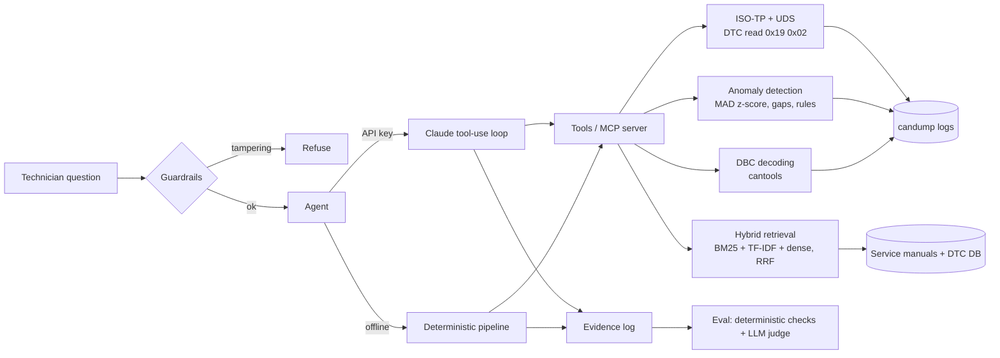

# AutoDiag Copilot

An LLM diagnostic assistant for automotive technicians. It reads a vehicle's **CAN bus log**, pulls trouble codes over **UDS (ISO 14229)**, finds anomalies in the signals, retrieves the right service procedures with **hybrid sparse + dense RAG**, and writes a cited diagnosis. All tools are exposed through an **MCP server**. Answer quality is tracked with a **held-out evaluation set and an LLM-as-judge**, with regression checks in CI.

```
$ python -m autodiag ask "DEMO-004 has several warning lamps flickering" --offline

Vehicle DEMO-004: 2020 petrol hatchback ... Several warning lamps flicker; ABS lamp on; occasional no-start
- UDS DTC read, ECM: U0121, U0001, P0562
- UDS DTC read, ABS: no_response

CAN log analysis (29.9 s) [log:DEMO-004]
- 12 V system below 11.8 V (9.0-11.4 s)
- 12 V system below 11.8 V (20.0-20.9 s)
- WheelSpeeds (0x1A0) missing for 3.299 s at 9.1 s (normal period 0.1 s)
...
Relevant procedures
- 12 V Charging System - System voltage low (P0562): ... [charging_system#system-voltage-low-p0562]
```

The answer joins up evidence from different layers: the voltage dip at 9 s, the ABS module going silent on the bus at 9.1 s, U0121 (lost communication with ABS) in the ECM, and no UDS reply from the ABS module. That points at the 12 V supply, not at the ABS module itself.

## Architecture



| Area | File | What it does |
|---|---|---|
| **CAN / DBC** | `autodiag/can.py`, `knowledge_base/demo_vehicle.dbc` | Real DBC file decoded with `cantools`; `candump -L` log parsing and writing |
| **ISO-TP + UDS** | `autodiag/uds.py` | Single/first/consecutive/flow-control frame reassembly, `0x19 0x02` ReadDTCInformation, SAE J2012 DTC encoding, status-byte flags, negative responses (NRC), ECU timeouts |
| **Anomaly detection** | `autodiag/anomaly.py` | Rolling median/MAD z-score spikes, message-gap detection (a module dropping off the bus), physical plausibility rules |
| **Retrieval** | `autodiag/retriever.py`, `autodiag/dense.py` | BM25 (from scratch), TF-IDF, LSA dense embeddings, optional sentence-transformers and cross-encoder reranker, RRF fusion, glossary query expansion |
| **Agent** | `autodiag/agent.py` | Claude tool-runner loop, or an offline pipeline with multi-query retrieval; records every tool call as evidence |
| **MCP server** | `autodiag/mcp_server.py` | 6 tools over stdio for Claude Desktop, Claude Code or any MCP client |
| **Guardrails** | `autodiag/guardrails.py` | Refuses airbag/ABS/EGR/DPF tampering; adds warnings for HV, SRS and brake faults |
| **Evaluation** | `eval/` | Dev and held-out retrieval sets, end-to-end answer cases, LLM-as-judge faithfulness, CI regression baselines |

## Quick start

```bash
pip install -r requirements.txt

python -m autodiag vehicles
python -m autodiag ask "DEMO-001 rough idle, what should I check?"
python -m autodiag analyze DEMO-002                    # or any candump -L log file
python -m autodiag uds 5902FFC121002FC001002F0562002F  # decode a UDS payload
python -m autodiag decode 0x1A0 0000861072107C10       # decode one CAN frame

pytest -q
python eval/run_eval.py          # retrieval metrics, dev vs held-out
python eval/judge.py             # end-to-end answer metrics
```

**With Claude:** set `ANTHROPIC_API_KEY`. `ask` then runs Claude with the same six tools. It decides what to read, analyses the log itself and writes a cited diagnosis. Without a key, everything runs offline.

**Optional neural retrieval:** `pip install -r requirements-dense.txt` adds sentence-transformer embeddings (`st`, `hybrid+st` modes) and a cross-encoder reranker (`Retriever(rerank=True)`). These download models from Hugging Face.

### MCP (Claude Desktop / Claude Code)

```json
{
  "mcpServers": {
    "autodiag": { "command": "python", "args": ["-m", "autodiag.mcp_server"], "cwd": "/path/to/autodiag-copilot" }
  }
}
```

Tools: `lookup_dtc`, `search_service_manual`, `decode_can_frame`, `get_vehicle_snapshot`, `analyze_can_log`, `decode_uds_message`.

## CAN logs and anomaly detection

`scripts/generate_demo_logs.py` produces seeded, reproducible 30-second `candump` logs. Each has 10 Hz broadcast traffic with an injected fault, followed by UDS DTC-read sessions over ISO-TP (with flow control, multi-frame responses, and one ECU that never answers). CI regenerates the logs and fails if they differ from the committed files.

| Vehicle | Injected fault | What the detectors find |
|---|---|---|
| DEMO-001 | 9 misfire RPM dips at idle, +18 % long-term fuel trim | All 9 dips as spikes with no false positives, plus the fuel-trim rule |
| DEMO-002 | Front-left wheel speed drops to 0 three times while driving | 3 `wheel_speed_dropout` violations |
| DEMO-003 | HV cell temperature climbing past 55 °C, 0.42 V cell spread | `battery_overtemp`, `cell_imbalance` |
| DEMO-004 | 12 V dips; ABS module drops off the bus; ABS ignores the UDS request | 3.3 s gap in `WheelSpeeds`, `low_system_voltage`, ABS `no_response` |

The three detectors complement each other. A long dropout (1.3 s, more than half the rolling window) shifts the rolling median, so the spike detector misses it, but the plausibility rule catches it. The spike detector's noise scale is floored at the signal's DBC resolution and its global MAD, because quantised, near-flat signals otherwise produce MAD = 0 and flag every 1-bit step. These were real bugs I hit and fixed.

## Retrieval evaluation

Two question sets of 30 technician questions each, checking the top 5 retrieved passages. I used **dev** while building the retriever, including writing the glossary. I wrote **held-out** before running anything on it and have not tuned against it.

| Retriever | dev Hit@3 | dev MRR@5 | **held-out Hit@3** | **held-out MRR@5** |
|---|---|---|---|---|
| BM25 | 0.90 | 0.83 | 0.90 | 0.84 |
| BM25 + glossary | 0.97 | 0.89 | **0.93** | **0.85** |
| TF-IDF | 0.83 | 0.80 | 0.83 | 0.78 |
| LSA (dense) | 0.90 | 0.85 | 0.83 | 0.74 |
| Hybrid (BM25 + TF-IDF, RRF) | 0.90 | 0.83 | 0.87 | 0.81 |
| Hybrid + glossary *(agent default)* | **1.00** | 0.89 | 0.90 | 0.82 |
| Hybrid + LSA + glossary | 0.97 | **0.91** | 0.83 | 0.79 |

**Findings**
- **The dev score was optimistic, as expected.** Hybrid + glossary goes from 1.00 Hit@3 on dev to 0.90 on held-out. The glossary was written after seeing the dev misses.
- **Dense LSA embeddings didn't help.** With only 73 passages there's too little text to learn useful concept vectors, and adding LSA to the hybrid made held-out results worse. Sweeping the LSA size on dev only gave differences within one question, so I kept the original setting.
- **Plain BM25 + glossary is best on held-out.** I kept the hybrid default anyway, because I chose it before the held-out set existed, and switching to the held-out winner would leak test data into the design.
- **Neural embeddings and the cross-encoder reranker** are implemented but **not measured here**: the build environment blocks Hugging Face. Install `requirements-dense.txt` and run `python eval/run_eval.py` to add those rows.

## End-to-end answer evaluation

`eval/answers.jsonl` has 14 cases: vehicle diagnoses, single-code questions, safety-critical faults, two tampering requests, and a look-alike question that must *not* be refused. Each answer records the tool calls and results it used as evidence.

**Deterministic checks** (no API key, run in CI). Offline agent:

| citation validity | DTC recall | source recall | warning correct | refusal correct |
|---|---|---|---|---|
| 1.00 | 1.00 | 0.94 | 1.00 | 1.00 |

The one miss is real: for DEMO-004, ABS-related passages crowd out the CAN *lost-communication* procedure. It's the case the reranker is meant to fix.

**LLM-as-judge** (`python eval/judge.py --mode claude --judge`). Claude, constrained to a JSON schema, lists every claim in the answer and marks whether the recorded evidence supports it and whether its citation is correct. **Faithfulness** (supported claims / all claims) and **citation precision** are computed from those per-claim verdicts, not asked for as a score, so every number can be traced back to individual claims. I couldn't run it in the build environment (no API key), so there are no judge scores here yet. It costs a few cents per run.

**CI:** `run_eval.py --check` and `judge.py --check` fail the build if any metric drops more than 0.02 below `eval/baseline.json` / `eval/answer_baseline.json`.

## Knowledge base

- `dtc_codes.csv`: 40 OBD-II codes (P/C/B/U) with SAE J2012 generic descriptions, severity and common causes
- `manuals/*.md`: 8 service-procedure documents (misfire, fuel trim, catalyst/O2, EVAP, CAN bus, ABS, HV battery, charging)
- `demo_vehicle.dbc`: signal database for a fictional demo vehicle
- `logs/*.log` and `vehicles.json`: 4 simulated vehicles

> The manuals, DBC and vehicles are **illustrative, written for this project**. They are not OEM documents and shouldn't be used to repair a real vehicle.

## Next steps
- [ ] Run the neural dense retriever and cross-encoder reranker, and add their rows to the table
- [ ] Run the LLM judge on Claude-mode answers and publish faithfulness scores
- [ ] Grow the held-out set: 30 questions means one question moves Hit@3 by 0.03
- [ ] Replay real-vehicle `candump` captures and OEM-format DBC files
- [ ] More UDS services: `0x22` ReadDataByIdentifier for live PIDs, `0x19 0x04` freeze-frame snapshots
