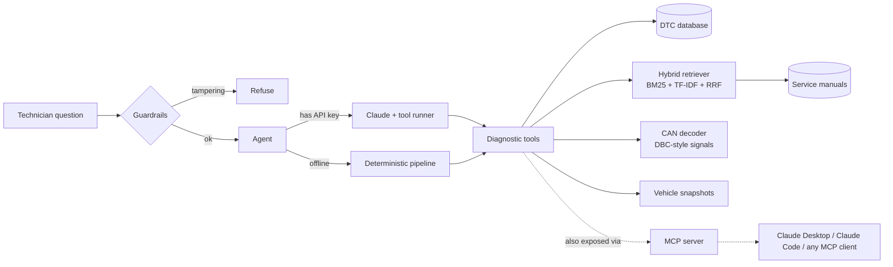

# AutoDiag Copilot

An LLM diagnostic assistant for automotive technicians. It combines **RAG** over service manuals and a trouble-code database with an **MCP server** of vehicle tools: DTC lookup, CAN frame decoding and live vehicle snapshots. It also has **safety guardrails** and a **retrieval evaluation harness**.

```
$ python -m autodiag ask "DEMO-002 has the ABS light on, what should I check?"
SAFETY:
  ! Braking-system faults affect stopping performance. Get the vehicle inspected before regular driving.

Vehicle DEMO-002: 2019 petrol SUV ... ABS and traction-control warning lamps on after driving through deep puddles
- CAN 0x1A0 WheelSpeeds: WheelSpeed_FL=0.0 km/h, WheelSpeed_FR=42.3 km/h, WheelSpeed_RL=42.1 km/h, WheelSpeed_RR=42.2 km/h
- C0035 Left Front Wheel Speed Sensor Circuit (severity: high) ... [dtc:C0035]
- Wheel speed sensor codes: Compare all four wheel speeds ... a faulty sensor reads zero ... [abs_wheel_speed#wheel-speed-sensor-codes]
```

## Architecture



| Component | File | What it shows |
|---|---|---|
| Hybrid retrieval | `autodiag/retriever.py` | BM25 implemented from scratch, TF-IDF with bigrams, **reciprocal-rank fusion**, and domain-glossary query expansion |
| MCP server | `autodiag/mcp_server.py` | Exposes 4 tools over the Model Context Protocol (stdio) |
| Agent | `autodiag/agent.py` | Claude tool-use loop with cited, structured answers. It falls back to an offline extractive mode when no API key is set |
| CAN decoding | `autodiag/can.py` | DBC-style bit-level signal decoding (little-endian, signed values, factor and offset) |
| Guardrails | `autodiag/guardrails.py` | Refuses tampering requests (airbag, ABS, EGR or DPF delete) and adds safety warnings for HV, SRS and brake issues |
| Evaluation | `eval/run_eval.py` | Hit@1, Hit@3 and MRR@5 on 30 labelled questions, comparing every retrieval method |
| Tests and CI | `tests/`, `.github/workflows/ci.yml` | 16 tests covering CAN round-trips, tools, retrieval, guardrails and the MCP server |

## Quick start

```bash
pip install -r requirements.txt

python -m autodiag vehicles                               # list simulated vehicles
python -m autodiag ask "DEMO-001 rough idle, what should I check?"
python -m autodiag ask "What does P0420 mean?" --offline
python -m autodiag decode 0x1A0 0000861072107C10          # raw CAN frame -> signals
python eval/run_eval.py                                   # retrieval metrics
pytest -q
```

**With Claude:** set `ANTHROPIC_API_KEY`. `ask` then runs Claude with the same tools, so it decides what to look up, decodes CAN data itself and writes a cited diagnosis. Without a key, everything still runs offline.

### Use the tools from Claude Desktop or Claude Code (MCP)

```json
{
  "mcpServers": {
    "autodiag": {
      "command": "python",
      "args": ["-m", "autodiag.mcp_server"],
      "cwd": "/path/to/autodiag-copilot"
    }
  }
}
```

### Docker

```bash
docker build -t autodiag .
docker run --rm autodiag ask "DEMO-004 several warning lamps flicker"
```

## Retrieval evaluation

These are results on 30 hand-labelled technician questions (`eval/questions.jsonl`), checking the top 5 retrieved passages:

| Method | Hit@1 | Hit@3 | MRR@5 |
|---|---|---|---|
| BM25 | 0.77 | 0.90 | 0.83 |
| TF-IDF | 0.73 | 0.83 | 0.80 |
| Hybrid (RRF) | 0.77 | 0.90 | 0.83 |
| BM25 + glossary | 0.80 | 0.97 | 0.89 |
| TF-IDF + glossary | 0.77 | 0.93 | 0.87 |
| **Hybrid + glossary** | **0.80** | **1.00** | **0.89** |

**What I learned**
- Hybrid fusion on its own didn't beat BM25. All three methods missed the same questions, so combining them couldn't help.
- Every miss was a **vocabulary mismatch** between workshop slang and manual wording: "lambda" vs "O2 sensor", "crank" vs "crankshaft", "ABS light" vs "lamp". A small automotive glossary for query expansion fixed it.
- **Caveat:** I wrote the glossary after seeing those misses, so the improvement is optimistic. A fair test needs a separate held-out question set (see next steps).

## Knowledge base

- `knowledge_base/dtc_codes.csv`: 40 OBD-II codes (P, C, B and U) with system, severity and common causes, covering SAE J2012 generic definitions.
- `knowledge_base/manuals/*.md`: 8 service-procedure documents on misfire, fuel trim, catalyst and O2 sensors, EVAP, CAN bus, ABS, HV battery and charging.
- `knowledge_base/can_signals.json`: a DBC-style signal database for a fictional demo vehicle.
- `knowledge_base/vehicles.json`: 4 simulated vehicles with DTCs, freeze-frame data and raw CAN frames.

> The manuals and the CAN database are **illustrative, written for this project**. They are not OEM documents and shouldn't be used to repair a real vehicle.

## Next steps
- [ ] Held-out question set and an LLM-as-judge evaluation of answer faithfulness
- [ ] Dense embeddings (e.g. sentence-transformers) as a third retriever in the fusion
- [ ] Parse real `.dbc` files with `cantools` and replay `candump` logs
- [ ] Streamlit UI with a chat view and plotted CAN signals
- [ ] UDS (ISO 14229) read-DTC request/response decoding
